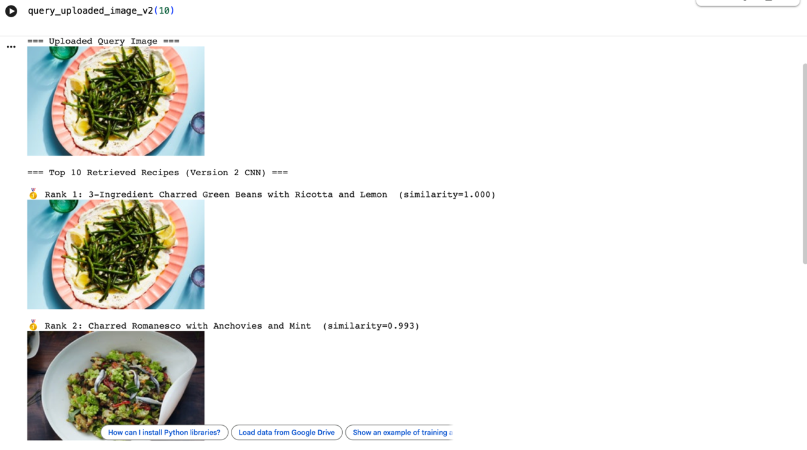
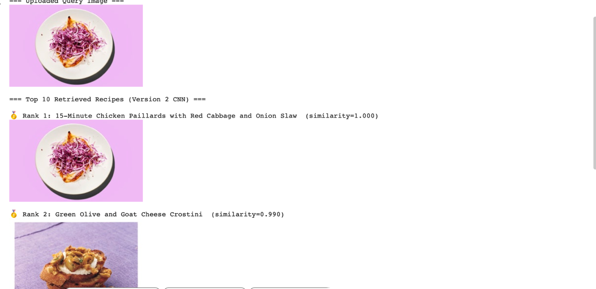

# CNN Image-to-Recipe Retrieval

A custom CNN that retrieves visually similar recipes for a photo of a dish, searching across 13,471 recipe images. Built for MET CS 767 (Boston University), Assignment 3.

> Code here was transcribed from screenshots in the original assignment write-up (the live Colab notebooks were on a university account that's since been disabled). Running `image_recipe_retrieval.py`'s architecture builder reproduces the exact model summary from the original notebook; the full pipeline needs the original 13,471-image dataset to run end-to-end.

## Part 1: CIFAR-10 architecture/hyperparameter study

Before building the custom application, this assignment started with a guided exercise: take a standard CNN on CIFAR-10 and systematically improve it. To make improvements visible, the training set was first reduced to 30% of its size (more data would have made the baseline too strong to meaningfully improve on).

| Step | Change | Test accuracy |
|---|---|---|
| 0 | Original (full data) baseline | 0.599 |
| 1 | Reduced to 30% of training data | ~0.48 |
| 2 | + Batch Normalization | ~0.54 |
| 3 | + Dropout (0.3) | ~0.51 |
| 4 | + Dense layer 64 → 128 units | ~0.50 |
| 5 | + Learning rate 0.001 → 0.0008 | ~0.55 |
| 6 | + Epochs 2 → 5 | ~0.60 |
| 7 | + Extra Conv2D layer | ~0.57 |
| — | Deliberately worse model (no pooling, high LR) | 0.40–0.45 |

See `cifar10_architecture_experiments.py` for the final combined configuration (BatchNorm + Dropout 0.3 + Dense-128 + extra Conv2D + tuned LR + 5 epochs).

## Part 2: Image-to-recipe retrieval application

**The problem.** Most food-image systems classify a photo into a single label ("pasta", "soup"). This application instead treats it as a retrieval problem: given a photo of a dish, find the most visually similar recipes from a large collection — more like a visual search engine than a classifier.

**Approach.** A small custom CNN (3 conv/pool blocks → global average pooling → 256-D dense layer → L2 normalization) is trained purely as an embedding generator — there's no final classification layer in the deployed pipeline. Every image in the 13,471-image recipe dataset is embedded once, and a k-nearest-neighbors index (scikit-learn, Euclidean distance over the L2-normalized embeddings) is built over all of those vectors. To answer a query, the uploaded photo is embedded the same way and the index returns the closest matches.

```
Input: 224×224×3 RGB image
  → Conv2D(32) → MaxPool
  → Conv2D(64) → MaxPool
  → Conv2D(128) → MaxPool
  → GlobalAveragePooling2D
  → Dense(256)
  → L2 normalize  →  256-D embedding, ready for k-NN search
```

**Results.** On 100 random sampled queries against the full 13,471-image dataset:

- Self-retrieval sanity check (does an image in the dataset retrieve itself first?): **0.98**
- Recall@10 (strict match: same title or ≥3 overlapping ingredients): **0.07**
- Recall@1: **0.01**

The low Recall@k numbers mostly reflect how strict the matching criterion is (most recipes in the dataset are visually similar to several others but have no exact textual duplicate), not that the retrieved images look wrong — see the examples below, where the top matches are genuinely close visually. The write-up also discusses training a Siamese/triplet-loss network on the full unlabeled dataset as the natural next step (no labels required, better suited to a pure similarity task), noted as a work-in-progress extension.

**Example queries:**





## Files

| File | Description |
|---|---|
| `image_recipe_retrieval.py` | The embedding CNN, dataset embedding, k-NN indexing, query, and evaluation functions |
| `cifar10_architecture_experiments.py` | The CIFAR-10 ablation study (final combined configuration) |
| `example_retrieval_1.png`, `example_retrieval_2.png` | Real query results from the original notebook |

## Tools

Python, TensorFlow/Keras, scikit-learn (NearestNeighbors), NumPy, Pandas

---
*Completed as part of graduate coursework (METCS767, Machine Learning) at Boston University.*
